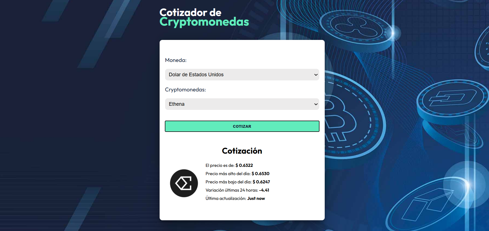

# 🪙 Cotizador de Criptomonedas  

Aplicación web desarrollada con **React**, **Zustand** y **Zod** para cotizar criptomonedas en tiempo real, consumiendo datos desde una API externa.  

---
## 📸Vista previa 


## 🚀 Características  

- 📈 Cotización en **tiempo real** de criptomonedas frente a distintas divisas.  
- ⚡ Manejo de **estado global** con Zustand.  
- ✅ **Validación de formularios y datos** con Zod.  
- 🌐 Consumo de **API pública de criptomonedas**.  
- 🎨 Interfaz responsive e intuitiva.  

---

## 🛠️ Tecnologías utilizadas  

| Tecnología     | Uso |
|----------------|-----|
| **React + Vite** | Framework y bundler |
| **TypeScript**   | Tipado estático |
| **Zustand**      | Estado global |
| **Zod**          | Validación de datos |
| **Axios**| Consumo de API |
| **TailwindCSS**  | Estilos |

## ⚡ Instalación y ejecución

1. Clonar el repositorio
`````
git clone https://github.com/Agusme/CryptoMonedas.git
cd cotizador-cripto
`````

2. Instalar dependencias
`````
npm install
`````

3. Iniciar en modo desarrollo
`````
npm run dev
`````
## 👩‍💻 Autor

Desarrollado por: Agustina Mena

- 💼 [LinkedIn](https://www.linkedin.com/in/agustina-mena/)

- 📂 [Portafolio](https://portfolioagustinamena.netlify.app/)

- 🐙 [GitHub](https://github.com/Agusme)